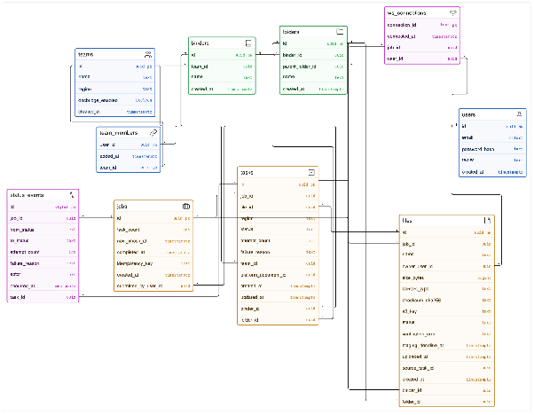

# Database schema

One PostgreSQL database; every table has one writer service, enforced with one role per service
([ADR-014](../adr/014-table-ownership.md)). The implementation is `db/migrations/`; this page is
the design it follows.



Source diagram: <https://app.eraser.io/workspace/NKZPoDlE564EiZkaCeT1?diagram=_R63ni76PtXsrkApbvZ3T>

## Ownership

| Owner (role) | Tables |
|---|---|
| Auth (`auth_svc`) | users, refresh_tokens, service_clients |
| Platform (`platform_svc`) | teams, team_members, binders, folders, documents |
| DocBridge (`docbridge_svc`) | jobs, files, tasks, status_events, ws_connections |
| Task worker (`worker_svc`) | none; column-level `UPDATE` on tasks, `INSERT` on status_events |

## Schema as designed in the PAS

Read it together with the changes in the next section, which came later and win where they
conflict.

```sql
users (
  id            uuid PRIMARY KEY DEFAULT gen_random_uuid(),
  email         citext UNIQUE NOT NULL,
  password_hash text NOT NULL,
  name          text NOT NULL,
  created_at    timestamptz NOT NULL DEFAULT now()
);

teams (
  id                 uuid PRIMARY KEY,
  name               text NOT NULL,
  region             text NOT NULL,
  docbridge_enabled  boolean NOT NULL DEFAULT true,
  created_at         timestamptz NOT NULL
);

team_members (
  team_id  uuid NOT NULL REFERENCES teams(id),
  user_id  uuid NOT NULL REFERENCES users(id),
  added_at timestamptz NOT NULL DEFAULT now(),
  PRIMARY KEY (team_id, user_id)
);

binders (
  id         uuid PRIMARY KEY,
  team_id    uuid NOT NULL REFERENCES teams(id),
  name       text NOT NULL,
  created_at timestamptz NOT NULL
);

folders (
  id               uuid PRIMARY KEY,
  binder_id        uuid NOT NULL REFERENCES binders(id),
  parent_folder_id uuid REFERENCES folders(id),  -- NULL = binder root
  name             text NOT NULL,
  created_at       timestamptz NOT NULL DEFAULT now()
);

jobs (
  id                   uuid PRIMARY KEY,
  submitted_by_user_id uuid NOT NULL REFERENCES users(id),
  task_count           int NOT NULL,
  next_check_at        timestamptz,           -- watchdog re-arm guard
  completed_at         timestamptz,           -- set when the last task resolves; drives 30-day retention
  idempotency_key      text,                  -- NULL when the client omits the header
  created_at           timestamptz NOT NULL
);

files (
  id                  uuid PRIMARY KEY,
  owner_user_id       uuid NOT NULL REFERENCES users(id),  -- the onBehalfOf user
  job_id              uuid NOT NULL REFERENCES jobs(id),

  -- content
  name                text NOT NULL,
  size_bytes          bigint NOT NULL,
  content_type        text NOT NULL,
  checksum_sha256     text NOT NULL,      -- client-declared, verified by S3 + worker + platform
  s3_key              text NOT NULL,      -- staging/{owner_user_id}/{id}

  -- lifecycle
  status              text NOT NULL DEFAULT 'pending'
                      CHECK (status IN ('pending','uploaded','expired','ingested')),
  verification_error  text,               -- why the arrived bytes were rejected; NULL when clean
  staging_deadline_at timestamptz NOT NULL,
  uploaded_at         timestamptz,

  -- placement (set on ingest)
  binder_id           uuid REFERENCES binders(id),
  folder_id           uuid REFERENCES folders(id),
  source_task_id      uuid UNIQUE,        -- idempotency key for ingest

  created_at          timestamptz NOT NULL,

  CHECK ((status = 'ingested') = (binder_id IS NOT NULL)),
  CHECK (folder_id IS NULL OR binder_id IS NOT NULL),
  CHECK (status <> 'ingested' OR verification_error IS NULL)
);

tasks (
  id                   uuid PRIMARY KEY,
  job_id               uuid NOT NULL REFERENCES jobs(id),
  file_id              uuid NOT NULL REFERENCES files(id),
  team_id              uuid NOT NULL REFERENCES teams(id),
  binder_id            uuid NOT NULL REFERENCES binders(id),
  folder_id            uuid REFERENCES folders(id),  -- NULL = binder root
  region               text NOT NULL,
  status               text NOT NULL DEFAULT 'pending'
                       CHECK (status IN ('pending','in_progress','completed','failed')),
  attempt_count        int NOT NULL DEFAULT 0,
  failure_reason       text,
  platform_document_id uuid,
  created_at           timestamptz NOT NULL,
  updated_at           timestamptz NOT NULL
);

ws_connections (
  connection_id text PRIMARY KEY,                -- API Gateway connection id
  user_id       uuid NOT NULL REFERENCES users(id),
  job_id        uuid REFERENCES jobs(id),        -- currently subscribed job
  connected_at  timestamptz NOT NULL
);

status_events (
  id              bigint PRIMARY KEY GENERATED ALWAYS AS IDENTITY,
  job_id          uuid NOT NULL REFERENCES jobs(id),
  task_id         uuid REFERENCES tasks(id),          -- NULL = job-level
  from_status     text,                               -- NULL = job created
  to_status       text NOT NULL,
  attempt_count   int,
  failure_reason  text,
  actor           text NOT NULL CHECK (actor IN ('api','delivery','watchdog','dlq')),
  occurred_at     timestamptz NOT NULL DEFAULT now()
);
```

## Changes decided after the design

From PAS-002 "Decisions". Full text in [../milestones.md](../milestones.md#decisions-after-the-design).

| Decision | Change |
|---|---|
| 1. Refresh tokens | New `refresh_tokens(id, user_id, family_id, token_hash, expires_at, used_at, revoked_at, created_at)`, owned by auth. |
| 3. Split `files` | `files` is the staging object only, one per upload: status `pending \| uploaded \| rejected \| expired`. Placement columns, `source_task_id` and `ingested` are dropped. New platform-owned `documents(id, team_id, binder_id, folder_id, name, size, content_type, sha256, storage_key, source_task_id UNIQUE, created_by, created_at, deleted_at)`; `tasks.platform_document_id` links them. |
| 5. Task lease | Add `tasks.lease_expires_at`. |
| 6. Idempotency key | Partial UNIQUE on `jobs(submitted_by_user_id, idempotency_key)`, plus `jobs.request_hash`. |
| Small items | Add `'upload'` to the `status_events.actor` CHECK. |

The milestone breakdown also needs these indexes: `folders(binder_id, parent_folder_id)` (M1);
`tasks(job_id, status)`, `jobs(next_check_at) WHERE completed_at IS NULL`,
`status_events(job_id, occurred_at)` (M2); `tasks(team_id, job_id)`, `team_members(user_id)` and a
trigram index on document names (M4).
