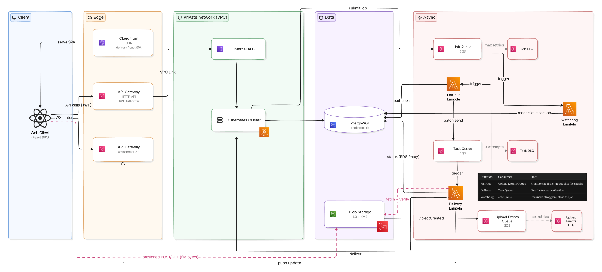
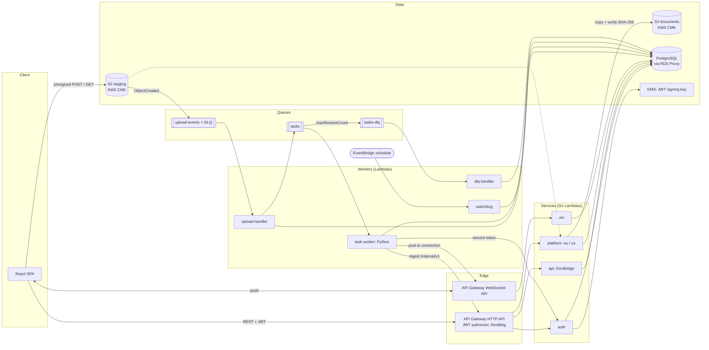

# System design

The image is the PAS original, drawn before [ADR-010](../adr/010-compute-api-gateway-and-lambda.md):
it shows an internal ALB and a Kubernetes cluster for the services. Today every service is a Lambda
behind API Gateway, as below.

## Components

| Component | Responsibility |
|---|---|
| Web client (React SPA) | File selection, destination mapping, job submission, the job and task dashboard. Uploads and downloads bytes directly to and from the staging bucket with presigned URLs. |
| API Gateway (HTTP API) | The single public entry point for API traffic. Validates JWTs before anything reaches a service; applies throttling. Never carries file bytes. ([ADR-001](../adr/001-route-traffic.md)) |
| API Gateway (WebSocket API) | Persistent connections for live task and job updates. ([ADR-004](../adr/004-status-updates.md)) |
| Auth service | Registration, login, credential storage, refresh-token rotation, user and service JWT issuance, JWKS. The only component that handles passwords. ([ADR-013](../adr/013-own-token-issuer.md)) |
| DocBridge API | Job submission (job, files and tasks in one transaction), presigned upload and download URLs, job and task reads. |
| Document platform | One deployment per region. Browse (teams, binders, folders), documents (search, rename, delete), and the `/internal/v1` ingest API used by the worker. |
| Blob storage (S3 + KMS) | Staging bucket: uploads, encrypted at rest, 30-day retention after job completion. Documents bucket: owned by the platform, written at ingest. |
| PostgreSQL | One instance; every table has one writer service, enforced with one role per service. ([ADR-014](../adr/014-table-ownership.md)) |
| Queues (SQS + DLQs) | `upload-events`: one message per file whose bytes landed. `tasks`: one message per task; its DLQ receives tasks that ran out of retries. ([ADR-002](../adr/002-async-processing.md), [ADR-009](../adr/009-file-arrival-detection.md)) |
| Worker tier (Lambda) | `upload-handler` (fan-out: verify, promote the file, batch-enqueue its tasks), task worker (delivery to the platform), `watchdog` (on a schedule: lost events, expired uploads, expired leases, job completion), `dlq-handler` (marks tasks failed with `RETRIES_EXHAUSTED`), `ws` (WebSocket routes). Scales per message, to zero when idle; Postgres through RDS Proxy. ([ADR-006](../adr/006-queue-consumer-compute.md)) |

The PAS also describes a job queue carrying a delayed watchdog message per job. The implementation
uses an EventBridge schedule that scans jobs with `next_check_at <= now()` instead (M0 breakdown,
"processing"); the watchdog's behaviour is the same.
