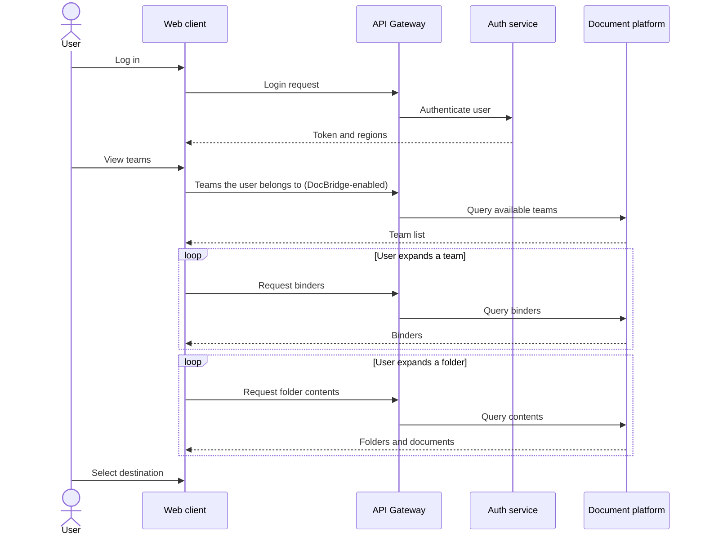
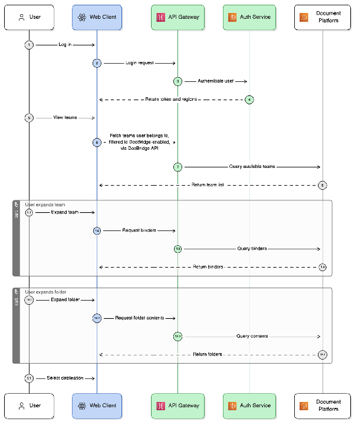
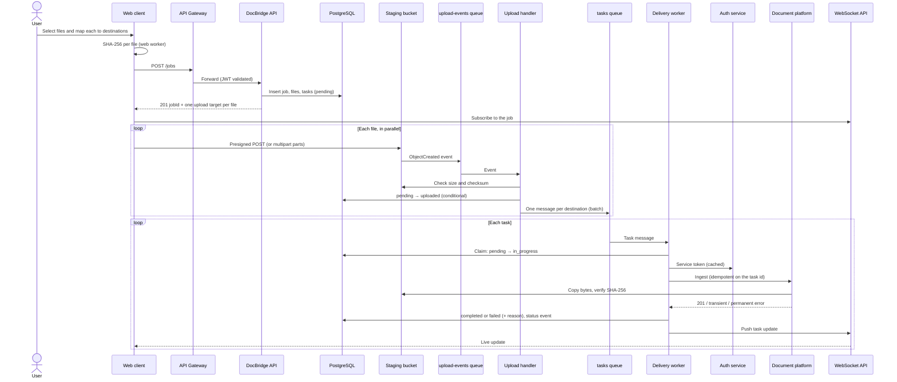
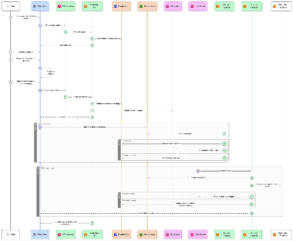
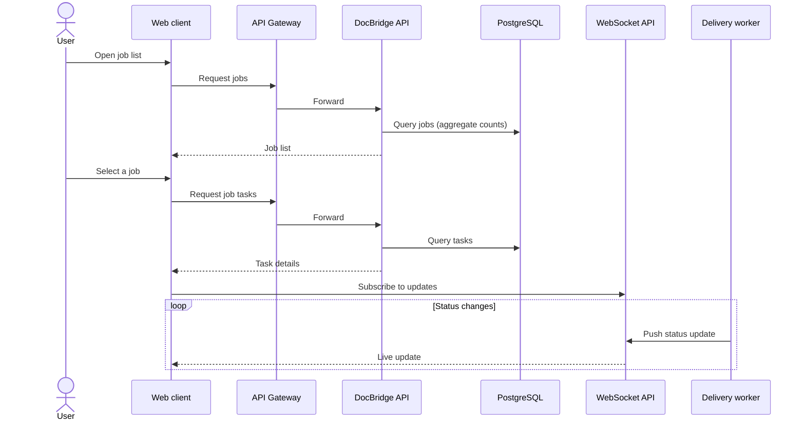
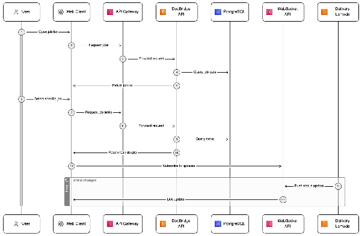
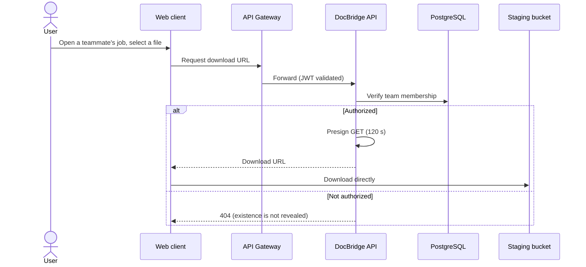
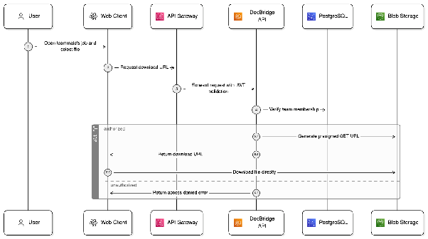
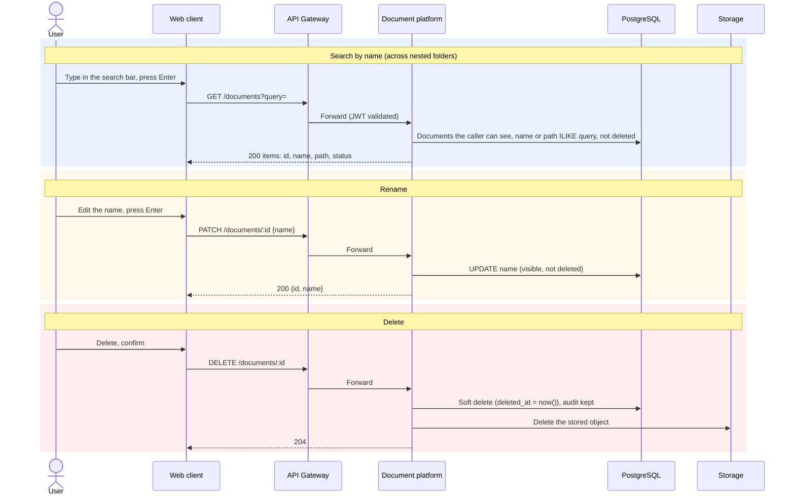
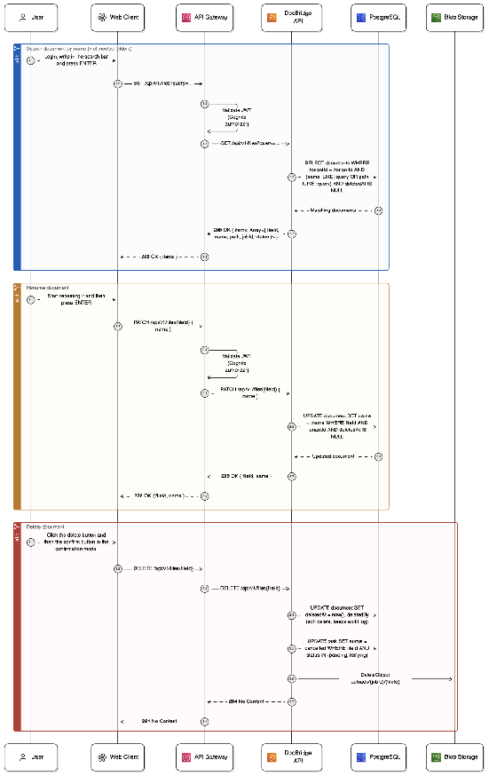

# Blueprint

Source: DocBridge PAS-002. What the system must do is in [requirements.md](requirements.md);
how it is built is in [architecture/](architecture/README.md).

## What problem we're solving and why

Clinical trial coordinators routinely **need to upload the same set of files to many destinations
at once**. The client needs a tool that lets a user:

- select multiple files in one session, seeing and acting only on the parts of the hierarchy they
  are authorized to access;
- map each file to one or more destinations in the hierarchy (teams, binders, folders);
- submit the whole batch in one action;
- track the progress of every individual upload;
- know exactly which uploads succeeded and which failed.

DocBridge is a standalone web application that delivers files into the document platform through
its API.

**Current state.** Ten regulatory files must land in 15 different team binders across 5 hospitals.
Today that is one file at a time, one destination at a time: slow and error-prone.

**Impact.** Without a tool like this, time is wasted and mistakes happen, because there is no single
source of truth and no central place to handle the files.

## Job stories

- When a **guest lands on the application**, redirect them to the `/login` page, so that **the
  system is usable only by authenticated, authorized users**.
- When a **user enters valid credentials**, redirect them to the dashboard, so that they can
  **browse the files available to them** (based on real permissions).
- When a user **selects a destination and a file to upload**, provide a **job submission view**,
  so that they can **see the details and status** of every file in the job.
- When a user **searches for a file**, show every matching file with its storage path, so that they
  find what they need without navigating teams, binders and folders.
- When a user **selects a document**, let them **view its contents** without downloading it, and
  **download it** when needed.
- When a user **selects a document**, let them **edit its title or destination**, so that files
  stay correctly organised.
- When a user **selects a document**, let them **delete it**, so that they can remove files they no
  longer need.
- When a user **checks the audit trail**, show **who sent each document**, which document, where it
  was placed and whether the send succeeded, so that every transfer can be traced.

## User flows

Each flow has a Mermaid transcription (reviewable in diffs) and the original diagram from the PAS.
The originals predate some later decisions (for example, they show a Cognito authorizer, while
[ADR-013](adr/013-own-token-issuer.md) has our own issuer); where they disagree, the decisions in
[milestones.md](milestones.md#decisions-after-the-design) and the ADRs win.

### Flow 1: Browse files

1. **Log in**.
2. The session is kept with **token-based authentication**.
3. **Browse the files** available, based on real permissions.

### Flow 2: Distribute files (with live updates)

1. Select one or more **destinations**: a binder or a folder nested inside it.
2. Submit an upload job, then follow the details and status of every file, so the user understands
   what is happening during delivery.

### Flow 3: Track and job history

1. **Track** every document sent, with a clear log of what was submitted, when and by whom.
2. See the **history of submitted jobs**.

### Flow 4: Retrieve a file

1. **View** a file (without downloading it) and **download** it.

### Flow 5: Interact with the platform

1. **Search** for a document by name, across nested folders.
2. **Edit** the document's title or its destination.
3. **Delete** the document.
4. **Outcome:** the user can navigate and work with the uploaded files inside the platform.

Search, rename and delete belong to the Platform API since decision 3 ("Split files"); the
original diagram shows them on the DocBridge API.

## Decisions with architectural impact

| Question | Record |
|---|---|
| How do we route public API traffic from the internet to our internal services? | [ADR-001](adr/001-route-traffic.md), [ADR-010](adr/010-compute-api-gateway-and-lambda.md) |
| How do we handle async job tasks independently of each other? | [ADR-002](adr/002-async-processing.md) |
| How do we deploy and configure the system (automation, configuration, secrets)? | [ADR-003](adr/003-deployment-and-configuration.md) |
| How does the browser receive task and job status updates while a job runs? | [ADR-004](adr/004-status-updates.md) |
| Do file bytes go straight between the browser and S3 (presigned URLs), or through our servers? | [ADR-005](adr/005-file-uploads.md) |
| What compute runs the queue consumers? | [ADR-006](adr/006-queue-consumer-compute.md) |
| What compute runs the backend services, and how are they deployed? | [ADR-007](adr/007-backend-compute.md), [ADR-010](adr/010-compute-api-gateway-and-lambda.md) |
| How do delivery workers authenticate to the document platform? | [ADR-008](adr/008-worker-authentication.md) |
| What tells the system a file has arrived, and what enqueues its tasks? | [ADR-009](adr/009-file-arrival-detection.md) |

The full list, including the decisions recorded while building, is in [adr/](adr/README.md).
